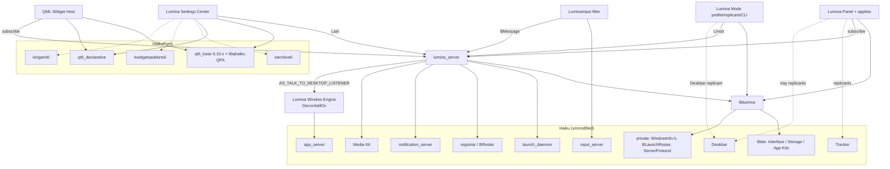
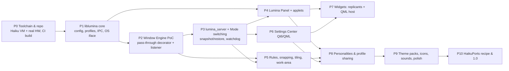

# 04 — Dependency Graph

## 1. Component dependencies

Solid arrows are hard dependencies; dotted arrows are optional ones.

## 2. Build-order / milestone dependencies

## 3. External dependency inventory

| Dependency | Needed by | Mandatory? | Status on Haiku |
|---|---|---|---|
| Haiku R1/beta6+ (hrev pinned) | all | yes | ✅ released 2026‑08‑26 |
| `DecorAddOn`/`DesktopListener` internal ABI | Window Engine | yes for WM features | ✅ present, ⚠️ unstable ABI |
| `WindowInfo.h` (private) | liblumina window registry | yes | ✅ used by Deskbar |
| `BLaunchRoster` (private) | mode switching (Deskbar enable/disable) | yes | ✅ used by `launch_roster` CLI |
| `BInputServerFilter` | LuminaInput | optional | ✅ public add-on API |
| `BNotification` | notifications | yes | ✅ public |
| Qt 6 base + QPA | Settings Center, Widget Host | optional | ✅ 6.10.3 |
| qt6_declarative | Settings Center, Widget Host | optional | ✅ |
| KF6 KArchive | profile bundles in Settings | optional | ✅ 6.29.0 |
| KF6 KWidgetsAddons / Kirigami6 | Settings UI | optional | ✅ 6.29.0 |
| KF6 KConfig | KDE-app colour/font sync | optional, later | ✅ 6.29.0 |
| KF6 KIO | — | **not used** | ✅ available if users want KDE apps |
| X11 / Xlibe / Wayland / D-Bus / PAM / systemd | — | **never** | — |

## 4. Upstream proposals (nice to have, never blocking)

| Proposal | Upstream | Unlocks |
|---|---|---|
| Expose `BWindow*` via `nativeResourceForWindow("bwindow")` | `threedeyes/qt6-haikuplugins` | QML windows can pin workspaces/feel directly |
| Stable, versioned desktop-listener add-on API | Haiku | Removes per-hrev rebuild of the engine |
| Public work-area / reserved-strut API | Haiku app_server | Panels without an engine add-on |
| Cursor theme setting | Haiku app_server | Cursor packs |
| Compositing / per-window alpha | Haiku app_server | Real transparency and window animations |
